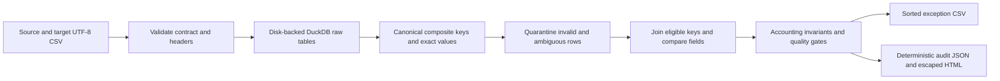

# Migration Reconciliation Lab

**Turn source and target CSV exports into a reproducible migration audit, with exact currency comparison and reviewable row-level exceptions.**

面向数据工程、数据分析与软件工程实习的独立作品：使用 Python 与 DuckDB SQL 检查迁移前后数据、隔离重复键、输出异常清单，并用可重现测试及真实本机测量验证实现。

Inspired by the practical problem of validating enterprise data migrations. This implementation, fixtures and reports are independent portfolio work. **No employer/client code, data, schemas or production performance claims are included.**

## Inspect the evidence

- [Example audit JSON](artifacts/demo-report/audit.json), [complete exception CSV](artifacts/demo-report/exceptions.csv) and [HTML report](artifacts/demo-report/report.html).
- [Measured million-row benchmark](artifacts/benchmark-1000000.json), including hardware/runtime metadata and measurement scope.
- [Contract example](examples/contract.json), [SQL reconciliation engine](reconcile_lab/engine.py), [edge-case tests](tests/test_reconciliation.py) and [interview guide](docs/interview-guide.md).
- Cross-platform CI configuration: Ubuntu/Windows, Python 3.11/3.12. The workflow runs tests and verifies the CLI's intentional data-failure exit.

## Run in five minutes

Python 3.11 or 3.12; no API keys, remote services or paid accounts. Commands are single lines and work from this repository on Windows, macOS or Linux.

```bash
python -m venv .venv
```

Activate the environment (`.venv\Scripts\Activate.ps1` in PowerShell, or `source .venv/bin/activate` in a POSIX shell), then:

```bash
python -m pip install -r requirements.txt
python -m pytest -q
python -m reconcile_lab generate-demo --out data/demo --rows 1000
python -m reconcile_lab reconcile --source data/demo/source.csv --target data/demo/target.csv --contract data/demo/contract.json --out runs/demo
```

The last command **intentionally returns exit 1** because the demo contains known anomalies. Open `runs/demo/report.html` and compare `audit.json` to the generated `data/demo/expected.json`. The committed example uses the same 1,000-row fixture.

| Demo result | Expected |
|---|---:|
| Actual source / target rows, including injected duplicates | 1,001 / 1,001 |
| Matched eligible keys | 995 |
| Changed matched keys / differing fields | 3 / 3 |
| Source-only / target-only rows | 2 / 1 |
| Unique rows blocked by opposing quarantine | 3 |
| Duplicate rows quarantined across both sides | 4 |
| Total exported exception records | 15 |

The generator refuses to overwrite existing demo inputs. Use a new directory for another fixture.

### Reconcile your own exports

Create a JSON contract following `examples/contract.json`, then supply two UTF-8 CSV files with those columns:

```bash
python -m reconcile_lab reconcile --source source.csv --target target.csv --contract examples/contract.json --out runs/custom --memory-limit 256MB
```

| Exit | Meaning |
|---|---|
| `0` | All configured quality gates pass |
| `1` | Reconciliation completed; one or more data-quality gates failed |
| `2` | Invalid contract/schema/CSV/path or execution failure; inspect stderr |

Outputs replace prior reports in the chosen output directory. Raw inputs are never modified. An output/input path collision is rejected. An execution failure can leave an earlier report in that directory: use the current exit status and run ID, or a fresh output directory for each run.

## How comparison works



**Composite keys:** each key column remains a separate SQL value; delimiter collisions cannot merge different tuples. CSVs are read as strings, so `001` and `1` remain different identifiers. Trimming and uppercasing are configurable for keys. A key containing a null or blank component is always invalid.

**Nulls and strings:** exact, case-sensitive `null_tokens` are applied after the configured trimming. Null equals null; null and a non-null value differ. String values are case-sensitive; only keys support uppercasing. `null_tokens: []` makes empty string fields literal values, while blank keys remain invalid.

**Currency values:** each decimal field uses exact `DECIMAL(28, scale)`, with scale 0-12 and an inclusive non-negative tolerance. At scale 2 with tolerance `0.01`, `100.00` and `100.01` match; `100.02` differs. Excess fractional digits, exponent notation, thousands separators, malformed values and overflow are explicit exceptions. No value is silently rounded to meet a contract, and a failed cast is never treated as an allowed null.

**Duplicate keys:** all rows carrying the ambiguous valid key are quarantined. The engine never chooses an arbitrary winner or fans out a many-to-many join. Unique opposing rows are labeled `blocked_by_quarantine`; only an absent comparable key without a known quarantined counterpart becomes `source_only` or `target_only`.

**Row accounting:** exclusive status precedence is `invalid_key -> duplicate_key -> invalid_value -> eligible`. For each side:

```text
raw rows = invalid-key rows + duplicate-key rows + invalid-value rows + eligible rows
eligible rows = matched rows + side-only rows + blocked rows
matched rows = clean matched rows + changed matched rows
```

Invalid cast cells are also exported independently, including on duplicate or invalid-key rows. Exception records therefore are not a partition of raw rows: one row may have several invalid cells or field differences. Each report declares its counts and checks these accounting identities.

## Audit and operational behavior

- Input and contract SHA256 hashes, byte sizes, engine version, memory setting and deterministic run ID appear in `audit.json`. Inputs are hashed again before report publication to detect concurrent edits.
- Sorted exports and a deterministic HTML preview produce byte-identical reports on reruns with identical input bytes, filenames, engine and settings. Measurement timestamps and timings belong only to benchmark output.
- CSV parsing is single-threaded to preserve input row identity; comparison uses disk-backed SQL tables and a spill directory. Python fetches aggregate counts and at most 50 preview exceptions, not the complete inputs or exception table.
- Temporary databases and spill files are cleaned up after the run. Disk space is required for raw, typed, classified and eligible tables. Reports contain only the declared key/field values and metadata; treat them according to the sensitivity of any inputs you choose to process.
- `256MB` configures DuckDB's managed memory, **not a complete process-RSS cap**. The project does not claim constant memory or production readiness.

## Actual local benchmark

```bash
python -m reconcile_lab benchmark --rows 1000000 --memory-limit 256MB --out artifacts/benchmark-1000000.json
```

One measured run on Windows, Python 3.11.6, DuckDB 1.5.6, Intel64 Family 6 Model 191, 16 logical CPUs, with the engine restricted to one thread:

| Measurement | Result |
|---|---:|
| Source plus target input rows | 2,000,002 |
| Reconciliation wall time | 16.603035 seconds |
| Total input rows / second | 120,460.02 |
| DuckDB managed memory setting | 256 MB |
| Generator anomaly oracle | Verified |

The measured reconciliation includes CSV parsing, SQL tables/classification/joins, hashes and all report exports; fixture generation took another 4.406339 seconds. This is one uniform synthetic workload. It is not an employer deployment, a production SLA, a peak-memory measurement or evidence for a 10-million-row claim. Run the benchmark on your own machine; skew, wide columns and high mismatch rates need separate measurements.

## What this adds to a portfolio

| Role | Evidence to discuss |
|---|---|
| Data engineering / analytics | SQL key semantics, data quality contracts, source-to-target reconciliation, exception traceability |
| Data science / ML | Reliable upstream data checks, explicit missingness, reproducibility, separating cell and row metrics |
| Software / AI applications | CLI contract, typed errors and exit statuses, automated edge-case tests, CI, escaped reports, bounded preview |

This project complements predictive modeling; it demonstrates how to establish trustworthy input data rather than claiming another model-accuracy improvement. See the [interview guide](docs/interview-guide.md) for the reasoning and concrete extensions to implement yourself.

## Scope and next steps

Supported now: two local CSV snapshots, required column validation, string and exact-decimal comparisons, scalar quality limits and deterministic audit exports. Deliberately unimplemented: SAP connectors, database CDC, timestamp/timezone semantics, fuzzy record linkage, incremental reconciliation, distributed compute and a reviewer approval workflow. The generic CSV contract is not an SAP product integration.

The code and documentation were prepared with AI assistance. Reproduce the examples and understand the failure cases before describing this implementation as a skill you can independently maintain.

MIT licensed.
